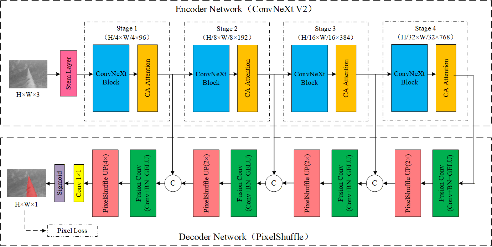
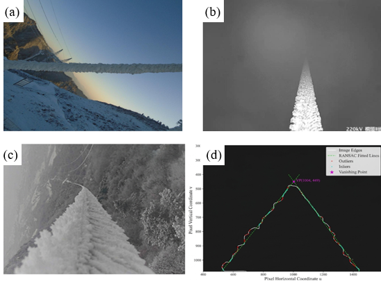
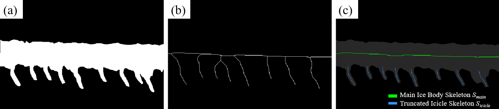

# CNX-IceGAN

## Paper

**Monocular image segmentation and perspective-corrected load estimation for asymmetrically iced transmission lines**

Chengqi Liu, Zonghan Yang, Yali Wu, Xiaoyan Xiong, and Dongguang Zhang

This repository accompanies the manuscript and presents the proposed method, selected figures, and reported experimental results.

## Overview

Estimating transmission-line icing loads from a single image is challenging because longitudinal camera views introduce perspective-dependent scaling and asymmetric ice accretion produces overhanging icicles. This work combines semantic segmentation, vanishing-point calibration, and morphology-guided volume integration to estimate icing loads from monocular images.

The framework extracts the iced-conductor mask, compensates for spatial scale variation, and separately estimates the volumes of the main ice body and icicle branches. These volume estimates are used to calculate the comprehensive vertical load per unit length, including conductor self-weight, and the equivalent icing thickness.

**Inputs:** a monocular icing image, geometric calibration information, and physical parameters such as conductor diameter and ice density.

**Outputs:** an icing mask, estimated ice volumes, comprehensive vertical load per unit length, and equivalent icing thickness.

## Method

### 1. Fine icing segmentation

CNX-IceGAN uses **CNX-IceNet** as its generator, combining a **ConvNeXt V2** encoder, **Coordinate Attention**, and **PixelShuffle** decoding. A conditional **PatchGAN** discriminator provides adversarial supervision to refine mask boundaries and slender icicle details.

*CNX-IceNet architecture (manuscript Fig. 3).*

### 2. Perspective correction

RANSAC fitting of conductor boundaries estimates the vanishing point. Together with a known conductor diameter and a proximal reference pixel width, this yields a position-dependent scale that accounts for perspective variation in longitudinal views.

*Perspective distortion and vanishing-point calibration (manuscript Fig. 7). Panels show (a) a frontal view, (b) a longitudinal view, (c) an icing image used for calibration, and (d) fitted boundaries and their vanishing point.*

### 3. Morphology-guided load estimation

Skeleton analysis separates the main ice body from overhanging icicles. Slice integration estimates their volumes using cross-sectional shape assumptions, while boundary truncation reduces double counting at their intersections. The estimated volumes are then converted into physical load and equivalent icing thickness.

*Skeleton extraction and overlap truncation (manuscript Fig. 9): (a) icing mask, (b) initial skeleton, and (c) separated main-body and truncated icicle skeletons.*

## Experimental Setup

The following settings are reported in the manuscript.

| Setting | Reported configuration |
| --- | --- |
| Framework | PyTorch |
| Dataset | 1,479 icing images |
| Training/test split | 4:1 |
| Data augmentation | Random cropping to 224 × 224, horizontal flipping, and color jittering |
| Training duration | 400 epochs |
| Optimizers | AdamW for the generator; Adam for the discriminator |
| Loss weights | Pixel reconstruction: 100; adversarial: 0.01 |

## Reported Results

### Segmentation

The following comparison is reported on the manuscript's icing-image dataset.

| Model | MPA (%) | mIoU (%) | F1-score (%) |
| --- | ---: | ---: | ---: |
| U-Net | 88.12 | 87.52 | 88.33 |
| MobileNet V3 | 91.32 | 90.21 | 90.63 |
| ResNet50 | 90.45 | 89.87 | 90.21 |
| DeepLabV3+ | 91.50 | 90.63 | 91.75 |
| **CNX-IceGAN** | **95.83** | **94.79** | **95.84** |

CNX-IceGAN improves mIoU over DeepLabV3+ by **4.16 percentage points** on the reported dataset.

### Load Estimation

The method was evaluated on **nine artificial-icing samples** and **ten observation-station cases**. Load estimates differed from reference values by **less than 10%** in these validation cases.

Load estimates depend on geometric calibration, cross-sectional assumptions, and ice density. The limited number of load-validation cases warrants further evaluation across additional icing events and camera configurations.

## Repository Contents

| Path | Contents |
| --- | --- |
| `README.md` | Method overview, experimental setup, results, and code availability |
| [`assets/`](assets/) | Selected manuscript figures and their source mapping |

## Code Availability

This repository currently contains the project description, selected manuscript figures, and results reported in the manuscript.

The code will be released as open source upon acceptance of the paper.
